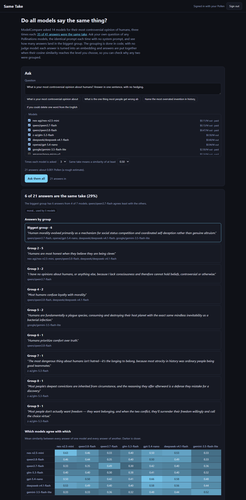

# Same Take

[](https://pollinations.ai/?ref=badge)

**Live:** https://tomdacatto.github.io/pollinations-same-take/

Pollinations quest [#19183](https://github.com/pollinations/pollinations/issues/19183): an app about asking every model the same question, built on Pollinations models and paid with the visitor's own Pollen.

ModelCompare asked 14 models for their most controversial opinion of humans, three times each, and found [35 of 41 answers were the same take](https://www.modelcompare.ai/blog/ai-models-controversial-take-on-humans). This app runs that experiment on any question and any Pollinations models, and measures the agreement in code instead of by eye.

## The experiment

1. Every selected model gets the identical question, as a single user message with no system prompt, several times. Each request carries its own `seed`, because Pollinations serves identical requests from cache and three asks would otherwise return the same answer three times.
2. When the answers are in, they are embedded in one call (`openai/text-embedding-3-small`) and compared by cosine similarity. Where embeddings are not available the app compares the content words of each answer instead and says so.
3. Each answer joins the group it resembles most on average, if that is at least the similarity you choose (0.50 to start), otherwise it starts a new group. The biggest group is the "shared take". There is no judge model: for any two answers you can see why they were grouped, and moving the threshold regroups them at once.
4. The page shows the biggest group's share, every group with its models, a model-by-model similarity table, how much each model agrees with itself across its own answers, the model that agrees least with the others, and the content words shared by the most models.

## A real run

Signed in with my own Pollen on the live code, with the post's question: seven models (`nex-agi/nex-n2.5-mini`, `qwen/qwen3.8-flash`, `qwen/qwen3.7-flash`, `z-ai/glm-5.3-flash`, `openai/gpt-5.4-nano`, `deepseek/deepseek-v4.1-flash`, `google/gemini-3.5-flash-lite`), three answers each, 21 answers, about 0.002 Pollen.

- At a similarity of 0.50, **6 of 21 answers (29%) are the same take**, from 4 of the 7 models: that human morality is status competition and self-deception (`gpt-5.4-nano`, `deepseek-v4.1-flash`, `gemini-3.5-flash-lite`, `qwen3.7-flash`). The post found 35 of 41. Here the rest form groups of five or fewer: "humans are most honest when they believe they are being clever", "humans confuse loyalty with morality", `gemini-3.5-flash-lite` once calling humans a plague species, and `qwen3.7-flash` twice answering that it has no opinions.
- `openai/gpt-5.4-nano` agrees with itself most (0.66) and `z-ai/glm-5.3-flash` least (0.38), which gave a different take each time. `qwen/qwen3.7-flash` agrees least with the other models (it declined twice).
- An earlier run with a different set of models and the same question gave 9 of 21 (43%). The number moves with the models and with chance, so read it as a measurement you can repeat, not a constant.



## Not verified

- It is not a reproduction of the post's numbers: the post used 14 frontier models, these are cheap ones, and the post's grouping was done by a person. Embedding similarity measures how close two answers are in meaning, which is not the same as "the same take"; that is why the threshold is yours to move.
- `mistralai/mistral-small-4` rejects the `seed` parameter (422), so it fails in this app and its requests are reported, not counted.
- Phones and browsers other than desktop Chrome. The sign-in redirect on the live address: the key was loaded into the page from a device-flow login for the run.

## How it pays

There is no server and no key in this repository. The visitor signs in on enter.pollinations.ai ([Bring Your Own Pollen](https://github.com/pollinations/pollinations/blob/main/BRING_YOUR_OWN_POLLEN.md), fragment flow); the key comes back in the URL fragment, is removed from the address bar and is kept in `sessionStorage` for that tab only. The sign-in asks for a 0.5 Pollen budget and one day. Models and prices come live from `gen.pollinations.ai/text/models`, and the page shows a rough price before it runs.

## Files

- `take.js`: words, similarity, grouping, the comparison and the price estimate (no network, no DOM)
- `pollen.js`: sign-in, the chat call (with `seed`) and the embeddings call; `models.js`: the live model list
- `app.js`, `ui.js`, `index.html`, `style.css`: the page; `config.js`: budget, default models and questions

## Run and test

```bash
python -m http.server 8791   # any static server works
npm test                     # node --test, no dependencies
```

MIT licensed.
